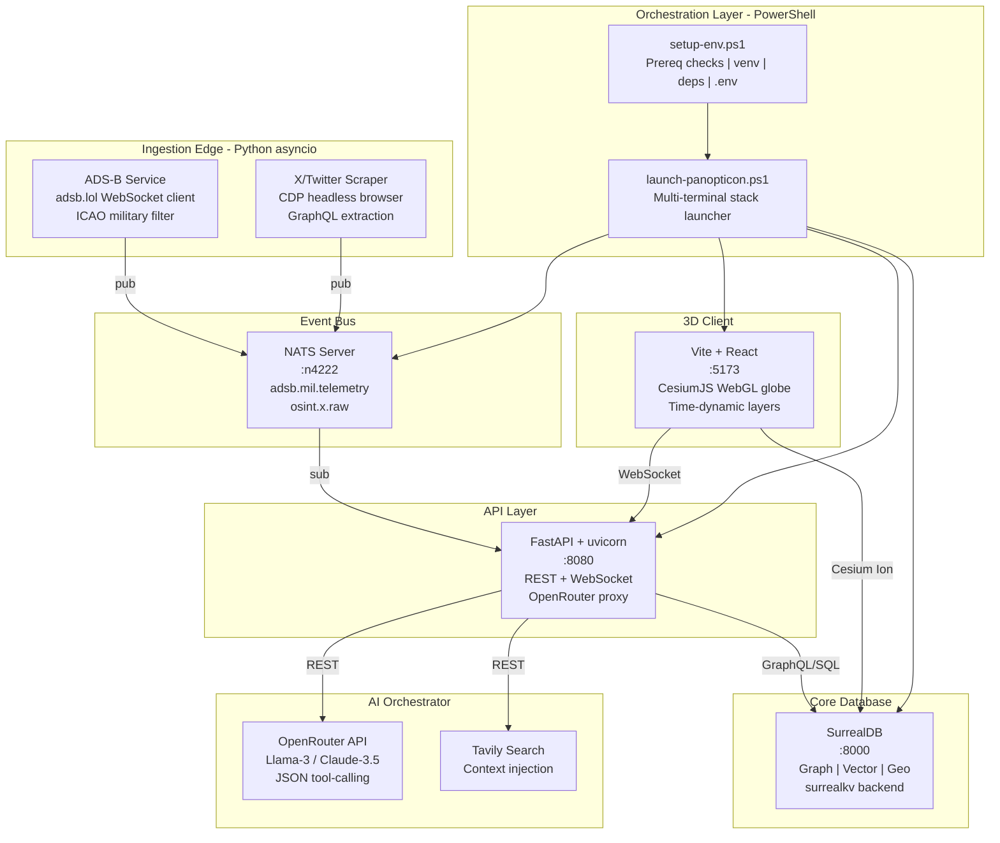
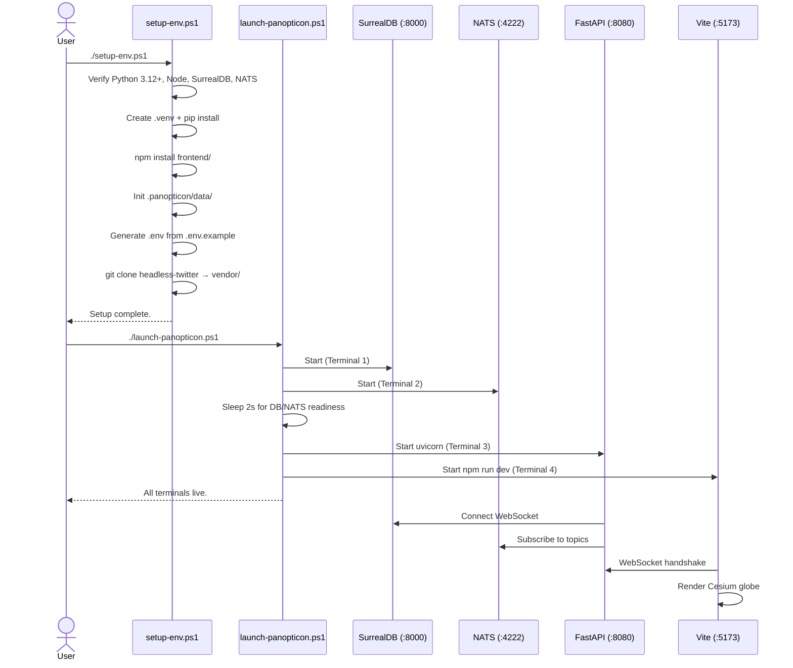

# Project Panopticon — Architecture & Phase 1 Implementation Plan

**Version**: 1.2 | **Codename**: Sovereign Native  
**Date**: 2026-05-15

---

## 1. System Architecture Overview



## 2. Filetree Design

```
Aura_cs/
├── prd.md                              # Product Requirements Document (existing)
├── plans/
│   └── plan.md                         # This architecture plan
├── .env.example                        # Environment variable template
├── .env                                # Generated environment (git-ignored)
├── .gitignore                          # Git exclusion rules
│
├── scripts/
│   ├── setup-env.ps1                   # [Phase 1] Environment bootstrapper
│   ├── launch-panopticon.ps1           # [Phase 1] Multi-terminal stack launcher
│   └── init_schema.surql               # [Phase 2] SurrealDB schema definition
│
├── .panopticon/
│   └── data/
│       └── README.md                   # Persistent storage marker
│
├── backend/
│   ├── main.py                         # FastAPI entry point + NATS subscriber
│   ├── requirements.txt                # Python dependency manifest
│   ├── config.py                       # Configuration loader (.env)
│   ├── services/
│   │   ├── __init__.py
│   │   ├── nats_client.py              # NATS pub/sub wrapper
│   │   ├── adsb_ingest.py              # ADS-B WebSocket client + ICAO filter
│   │   └── x_scraper.py                # CDP headless browser scraper (Phase 2)
│   ├── routers/
│   │   ├── __init__.py
│   │   ├── events.py                   # CRUD for geopolitical events
│   │   ├── aircraft.py                 # Aircraft entity endpoints
│   │   └── ai.py                       # OpenRouter + Tavily proxy
│   ├── db/
│   │   ├── __init__.py
│   │   └── surrealdb_client.py         # SurrealDB SDK wrapper
│   └── models/
│       ├── __init__.py
│       └── schemas.py                  # Pydantic models
│
├── frontend/
│   ├── package.json                    # Node dependencies
│   ├── tsconfig.json                   # TypeScript config
│   ├── vite.config.ts                  # Vite bundler config
│   ├── index.html                      # SPA shell
│   └── src/
│       ├── main.tsx                    # React entry point
│       ├── App.tsx                     # Root component
│       ├── components/
│       │   ├── Globe.tsx               # CesiumJS 3D globe wrapper
│       │   ├── LayerPanel.tsx          # Data layer toggle UI
│       │   ├── Timeline.tsx            # Temporal scrubber
│       │   └── EntityCard.tsx          # Entity detail popup
│       ├── hooks/
│       │   ├── useNATS.ts              # NATS WebSocket hook
│       │   └── useSurreal.ts           # SurrealDB query hook
│       ├── stores/
│       │   └── globeStore.ts           # Zustand state store
│       └── styles/
│           └── globe.css               # Cesium overrides
│
├── vendor/
│   └── headless-twitter/               # Cloned from om-ashish-soni/headless-twitter
│
└── config/
    └── icao_filter.json                # Military ICAO hex code whitelist
```

## 3. Phase 1 Deliverables — Detailed Specifications

### 3.1 [`scripts/setup-env.ps1`](scripts/setup-env.ps1)

**Purpose**: Zero-touch environment bootstrapping. Must be idempotent (safe to re-run).

**Logic Flow**:
1. **Bootstrap check**: Test that script runs under PowerShell 7+ (`pwsh`), auto-relaunch if in Windows PowerShell 5.x
2. **Prerequisite verification** (ordered, fail-fast with actionable messages):
   - `python --version` → parse, assert >= 3.12
   - `node --version` → parse, assert >= 18
   - `npm --version` → assert exists
   - `git --version` → assert exists
   - `surreal --version` → assert exists (SurrealDB CLI)
   - `nats-server --version` → if missing, download `nats-server.exe` (latest v2.x) from GitHub releases into a local `bin/` dir and add to PATH for the session
3. **Python venv**: Create `.venv/` at project root if absent; activate; pip-install from [`backend/requirements.txt`](backend/requirements.txt)
4. **Frontend deps**: `npm install` in [`frontend/`](frontend/) directory
5. **Storage init**: Create `.panopticon/data/` directory with a [`README.md`](.panopticon/data/README.md) marker explaining the directory's purpose
6. **Environment file**: If `.env` does not exist, copy `.env.example` → `.env` and warn the user to populate API keys
7. **Clone vendor repos**: If `vendor/headless-twitter/` does not exist, `git clone https://github.com/om-ashish-soni/headless-twitter.git vendor/headless-twitter`

**Dependencies list** ([`backend/requirements.txt`](backend/requirements.txt)):
```
fastapi>=0.115.0
uvicorn[standard]>=0.30.0
nats-py>=0.1.0
surrealdb>=0.12.0
python-dotenv>=1.0.0
httpx>=0.27.0
websockets>=12.0
pydantic>=2.0.0
playwright>=1.45.0
```

### 3.2 [`scripts/launch-panopticon.ps1`](scripts/launch-panopticon.ps1)

**Purpose**: Launch all 4 stack components in separate, visible PowerShell terminals.

**Logic Flow**:
1. Resolve absolute paths to all executables and directories
2. Source `.env` for environment variables
3. Launch terminals in this order with staggered delays:

| Terminal | Command | Window Title |
|----------|---------|--------------|
| T1 | `surreal start --log info --user root --pass root --bind 127.0.0.1:8000 surrealkv:.panopticon/data/panopticon.db` | `Panopticon: SurrealDB` |
| T2 | `nats-server -p 4222` | `Panopticon: NATS` |
| T3 | `.venv/Scripts/activate && uvicorn backend.main:app --host 127.0.0.1 --port 8080 --reload` | `Panopticon: FastAPI` |
| T4 | `npm run dev` (in `frontend/`) | `Panopticon: Vite` |

4. Use `Start-Process pwsh -ArgumentList "-NoExit", "-Command", "..."` pattern
5. On script exit (Ctrl+C in the orchestrator terminal), optionally kill all spawned processes

### 3.3 [`backend/main.py`](backend/main.py) — FastAPI Entry Point

**Minimal Phase 1 skeleton**:
- Load config from `.env` via `python-dotenv`
- Health-check endpoint: `GET /api/health` → `{"status": "ok", "components": {"surrealdb": "...", "nats": "..."}}`
- NATS subscriber boilerplate (connect, subscribe to `adsb.mil.telemetry` and `osint.x.raw`, log received messages)
- SurrealDB connection test on startup
- CORS middleware configured for `localhost:5173`

### 3.4 [`frontend/`](frontend/) — Vite + React + CesiumJS Skeleton

**Minimal Phase 1 skeleton**:
- Vite project with React + TypeScript
- [`cesium`](https://www.npmjs.com/package/cesium) npm package (v1.120+)
- [`resium`](https://www.npmjs.com/package/resium) (React bindings for Cesium) — optional, or raw Cesium
- Vite config with Cesium static assets plugin (`vite-plugin-cesium` or manual copy)
- Basic [`Globe.tsx`](frontend/src/components/Globe.tsx) rendering Cesium Viewer with default imagery
- Placeholder connection status indicator

### 3.5 [`scripts/init_schema.surql`](scripts/init_schema.surql) — Database Schema (Phase 2 ready)

Define SurrealDB tables and relations with geospatial indexing:

```surql
-- Entity tables
DEFINE TABLE aircraft SCHEMAFULL;
DEFINE FIELD icao_hex ON aircraft TYPE string ASSERT $value != NONE;
DEFINE FIELD callsign ON aircraft TYPE option<string>;
DEFINE FIELD coordinates ON aircraft TYPE geometry<point>;
DEFINE FIELD altitude ON aircraft TYPE option<float>;
DEFINE FIELD velocity ON aircraft TYPE option<float>;
DEFINE FIELD heading ON aircraft TYPE option<float>;
DEFINE FIELD aircraft_type ON aircraft TYPE option<string>;
DEFINE FIELD owner_entity ON aircraft TYPE option<record<entity>>;
DEFINE INDEX idx_aircraft_coords ON aircraft FIELDS coordinates GEOSPATIAL;

DEFINE TABLE event SCHEMAFULL;
DEFINE FIELD title ON event TYPE string;
DEFINE FIELD description ON event TYPE option<string>;
DEFINE FIELD coordinates ON event TYPE geometry<point>;
DEFINE FIELD event_type ON event TYPE string;
DEFINE FIELD severity ON event TYPE option<string>;
DEFINE FIELD source ON event TYPE option<string>;
DEFINE FIELD timestamp ON event TYPE datetime DEFAULT time::now();
DEFINE FIELD embedding ON event TYPE option<array<float>>;
DEFINE INDEX idx_event_coords ON event FIELDS coordinates GEOSPATIAL;
DEFINE INDEX idx_event_vector ON event FIELDS embedding MTREE DIMENSION 1536;

DEFINE TABLE entity SCHEMAFULL;
DEFINE FIELD name ON entity TYPE string;
DEFINE FIELD entity_type ON entity TYPE string;
DEFINE FIELD aliases ON entity TYPE option<array<string>>;
DEFINE FIELD coordinates ON entity TYPE option<geometry<point>>;

-- Graph edge tables
DEFINE TABLE belongs_to SCHEMAFULL TYPE RELATION IN aircraft OUT entity;
DEFINE TABLE involved_in SCHEMAFULL TYPE RELATION IN entity OUT event;
DEFINE TABLE related_to SCHEMAFULL TYPE RELATION IN event OUT event;
```

### 3.6 [`env.example`](.env.example)

```
# --- OpenRouter AI ---
OPENROUTER_API_KEY=sk-or-xxxxxxxxxxxxxxxxxxxxxxxx
OPENROUTER_MODEL=anthropic/claude-3.5-sonnet

# --- Tavily Search ---
TAVILY_API_KEY=tvly-xxxxxxxxxxxxxxxxxxxxxxxx

# --- SurrealDB ---
SURREAL_URL=ws://127.0.0.1:8000/rpc
SURREAL_NS=panopticon
SURREAL_DB=osint
SURREAL_USER=root
SURREAL_PASS=root

# --- NATS ---
NATS_URL=nats://127.0.0.1:4222

# --- ADS-B ---
ADSB_WS_URL=wss://api.adsb.lol/api/ws

# --- X/Twitter (Phase 2) ---
X_AUTH_TOKEN=
X_CSRF_TOKEN=
```

### 3.7 [`.gitignore`](.gitignore)

```
# Python
.venv/
__pycache__/
*.pyc
*.egg-info/

# Node
node_modules/
dist/

# Environment
.env

# Data (persistent storage — git-ignored, kept locally)
.panopticon/data/panopticon.db
.panopticon/data/*.db

# Binaries
bin/

# IDE
.vscode/
.idea/

# OS
Thumbs.db
.DS_Store
```

## 4. Component Interaction — Startup Sequence



## 5. Edge Cases & Failure Modes Handled

| Scenario | Handling in setup-env.ps1 |
|----------|--------------------------|
| PowerShell 5.x detected | Auto-relaunch with `pwsh`; error if not installed |
| Python < 3.12 | Fail with version comparison output |
| SurrealDB not on PATH | Fail with download link |
| NATS not on PATH | Auto-download binary to `bin/` |
| `.env` already exists | Skip generation, do not overwrite |
| `vendor/headless-twitter` already exists | Skip clone |
| Port 8000/4222/8080/5173 in use | Warn in launch script before starting |

## 6. Phase 1 Completion Criteria

- [x] Architecture document written
- [ ] `setup-env.ps1` executes without errors on a clean checkout
- [ ] `launch-panopticon.ps1` opens 4 separate terminal windows
- [ ] SurrealDB starts and accepts connections on `127.0.0.1:8000`
- [ ] NATS starts and accepts connections on `127.0.0.1:4222`
- [ ] FastAPI health check returns 200 at `http://127.0.0.1:8080/api/health`
- [ ] Vite dev server serves React app at `http://localhost:5173`
- [ ] CesiumJS globe renders in browser
- [ ] `.env` is git-ignored, `.env.example` is committed
- [ ] `vendor/headless-twitter` is cloned and available
- [ ] `init_schema.surql` is syntactically valid SurrealQL
